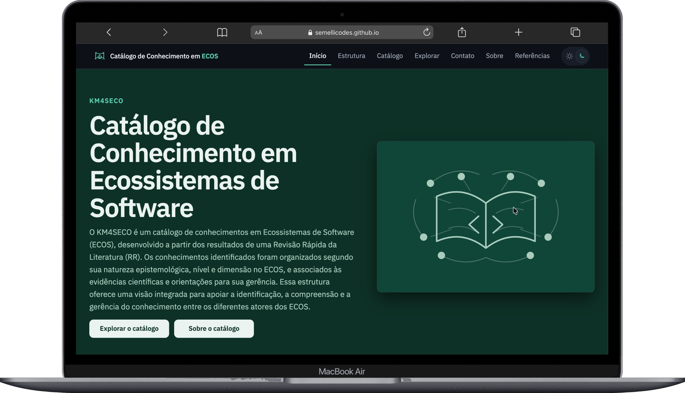
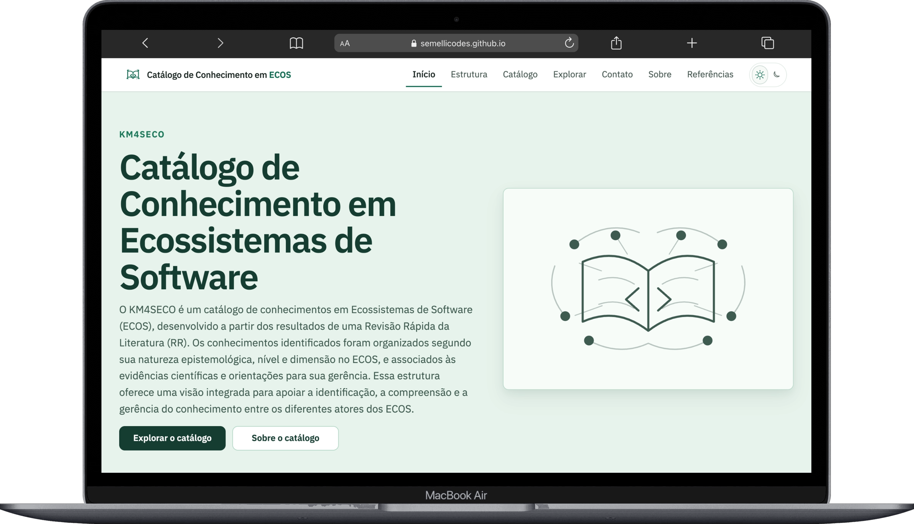
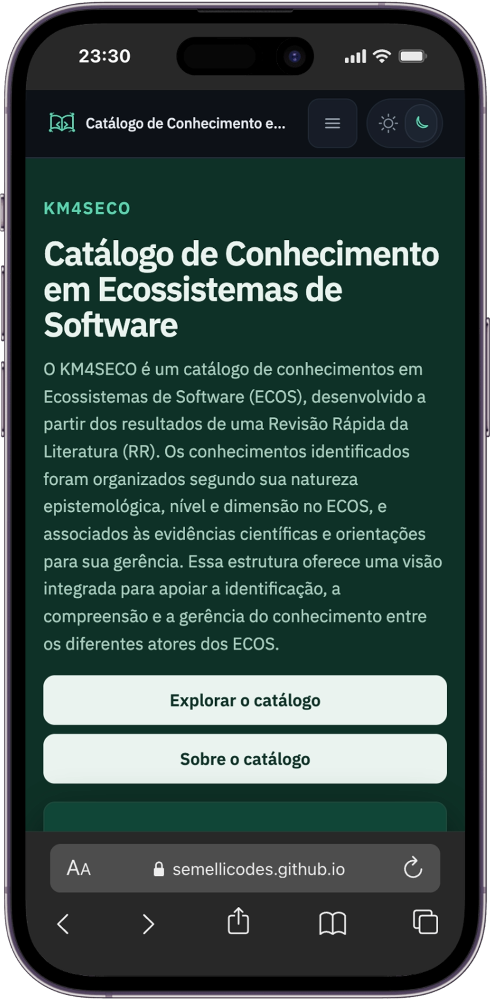
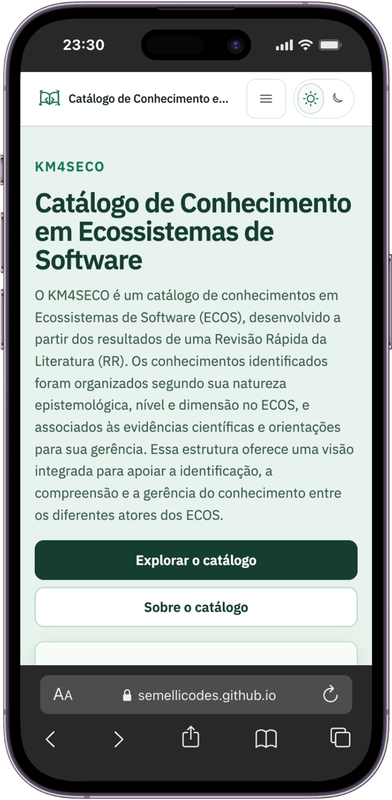
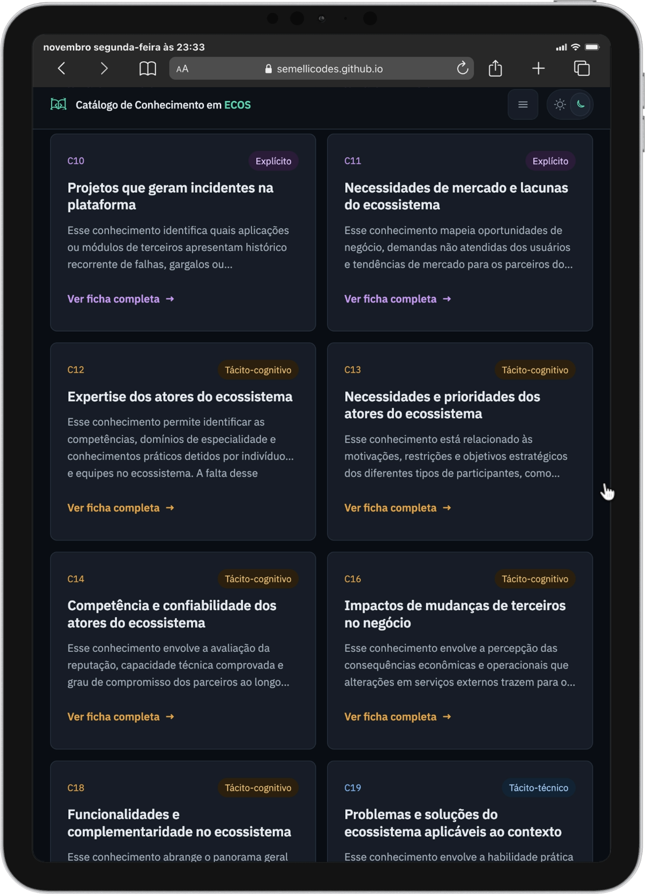
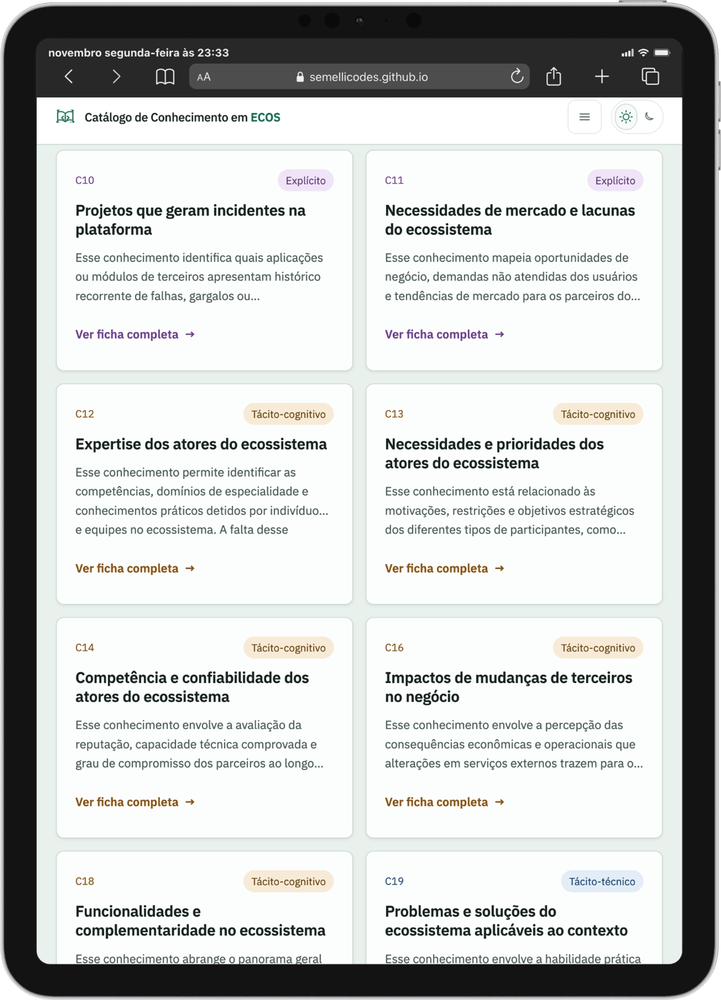
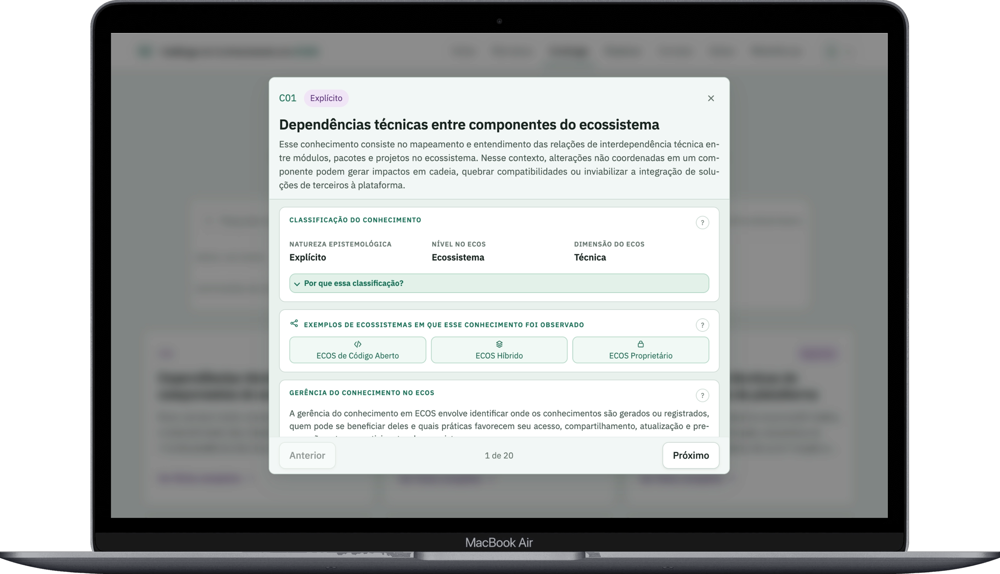
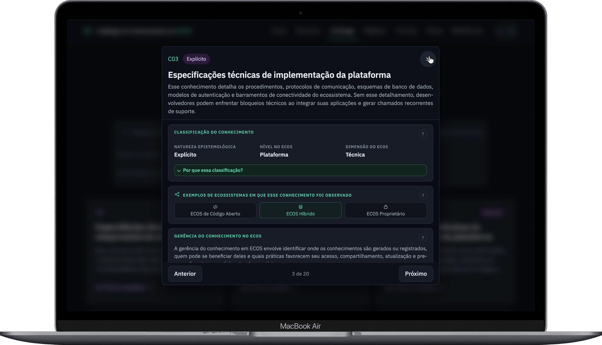
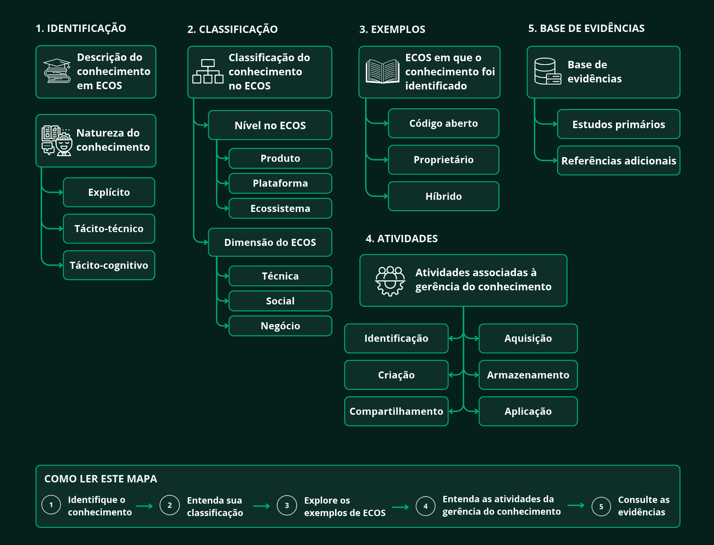
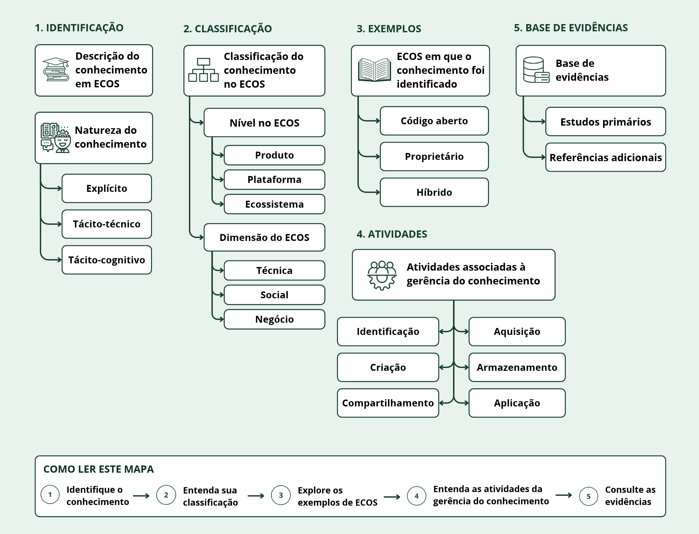

  <h1>KM4SECO</h1>

  

    <strong>Catálogo de Conhecimentos em Ecossistemas de Software</strong>
  

  

    Uma ferramenta web para consultar e explorar conhecimentos
    relacionados à gerência de conhecimento em Ecossistemas
    de Software (ECOS).
  

  

    <a href="https://semellicodes.github.io/catalogo-conhecimento-ecos/">
      Acessar o catálogo
    </a>
  

<h2>Sobre o projeto</h2>

  O KM4SECO foi desenvolvido como parte de um Trabalho de
  Conclusão de Curso (TCC) do Bacharelado em Sistemas de
  Informação da Universidade Federal Rural da Amazônia (UFRA),
  campus Capitão Poço.

  O catálogo reúne 20 conhecimentos identificados a partir
  de uma Revisão Rápida da Literatura, composta por 18 estudos
  primários relacionados à gerência de conhecimento em
  Ecossistemas de Software.

  A proposta é organizar esses conhecimentos em uma ferramenta
  de consulta, permitindo compreender suas características,
  identificar evidências na literatura e explorar práticas
  relacionadas à sua gerência.

<h2>Funcionalidades</h2>

<ul>
  <li>Consulta aos 20 conhecimentos identificados na pesquisa.</li>
  <li>Busca por nome, descrição ou identificador.</li>
  <li>Filtros por natureza epistemológica, nível e dimensão do ECOS.</li>
  <li>Fichas detalhadas com classificações, evidências e estudos associados.</li>
  <li>Orientações para identificação, registro, compartilhamento, organização e reutilização dos conhecimentos.</li>
  <li>Exploração de desafios relacionados à gerência de conhecimento.</li>
  <li>Mapa conceitual para visualização das relações entre conceitos.</li>
  <li>Consulta aos estudos primários utilizados na pesquisa.</li>
  <li>Interface responsiva com temas claro e escuro.</li>
</ul>

<h2>Organização dos conhecimentos</h2>

  Os conhecimentos são classificados conforme sua natureza
  epistemológica, considerando três categorias:

<ul>
  <li>
    <strong>Explícitos:</strong> conhecimentos que podem ser
    documentados, estruturados e compartilhados por meio
    de registros e artefatos.
  </li>
  <li>
    <strong>Tácito-cognitivos:</strong> conhecimentos relacionados
    à experiência, percepção e compreensão dos participantes.
  </li>
  <li>
    <strong>Tácito-técnicos:</strong> conhecimentos associados
    às habilidades práticas e à execução de atividades.
  </li>
</ul>

  Além da natureza epistemológica, o catálogo considera
  o nível e a dimensão em que cada conhecimento se manifesta
  no ecossistema.

<h2>Interface e responsividade</h2>

  A interface foi desenvolvida para permitir a navegação
  em diferentes tamanhos de tela, com suporte aos temas
  claro e escuro.

<h3>Página inicial em desktop</h3>

  
  

<h3>Página inicial em celular</h3>

  
  

<h3>Catálogo em tela compacta</h3>

  
  

<h3>Fichas detalhadas dos conhecimentos</h3>

  
  

<h3>Mapa conceitual</h3>

  
  

<h2>Tecnologias utilizadas</h2>

  O KM4SECO foi desenvolvido como uma aplicação web estática,
  utilizando:

<ul>
  <li><strong>HTML5:</strong> estrutura das páginas.</li>
  <li><strong>CSS3:</strong> estilização, temas e responsividade.</li>
  <li><strong>JavaScript:</strong> navegação, filtros, busca e interações.</li>
  <li><strong>GitHub Pages:</strong> hospedagem da aplicação.</li>
</ul>

  O projeto não depende de frameworks ou de um servidor
  de aplicação para sua execução.

<h2>Metodologia</h2>

  O conteúdo do catálogo foi obtido por meio de uma
  Revisão Rápida da Literatura, conduzida para investigar
  os conhecimentos relevantes à gerência de conhecimento
  em Ecossistemas de Software.

  A pesquisa considerou três questões principais:

<ol>
  <li>Quais tipos de conhecimento são identificados em ECOS?</li>
  <li>Quais soluções apoiam a gerência desses conhecimentos?</li>
  <li>Quais desafios estão relacionados à sua gerência?</li>
</ol>

  Após a seleção e análise dos estudos primários, foram
  consolidados 20 conhecimentos, utilizados como base
  para a construção do catálogo.

<h2>Como executar</h2>

  O catálogo pode ser acessado diretamente pelo GitHub Pages:

  <a href="https://semellicodes.github.io/catalogo-conhecimento-ecos/">
    https://semellicodes.github.io/catalogo-conhecimento-ecos/
  </a>

  Para executar localmente, clone o repositório e abra
  o arquivo <code>index.html</code> no navegador.

<h2>Autoria</h2>

  <strong>Paula Sêmelli Araújo do Amaral</strong> 
  Bacharelado em Sistemas de Informação 
  Universidade Federal Rural da Amazônia (UFRA) 
  Campus Capitão Poço

  <a href="https://github.com/semellicodes">GitHub</a>
  |
  <a href="https://www.linkedin.com/in/paulasemelli/">
    LinkedIn
  </a>

